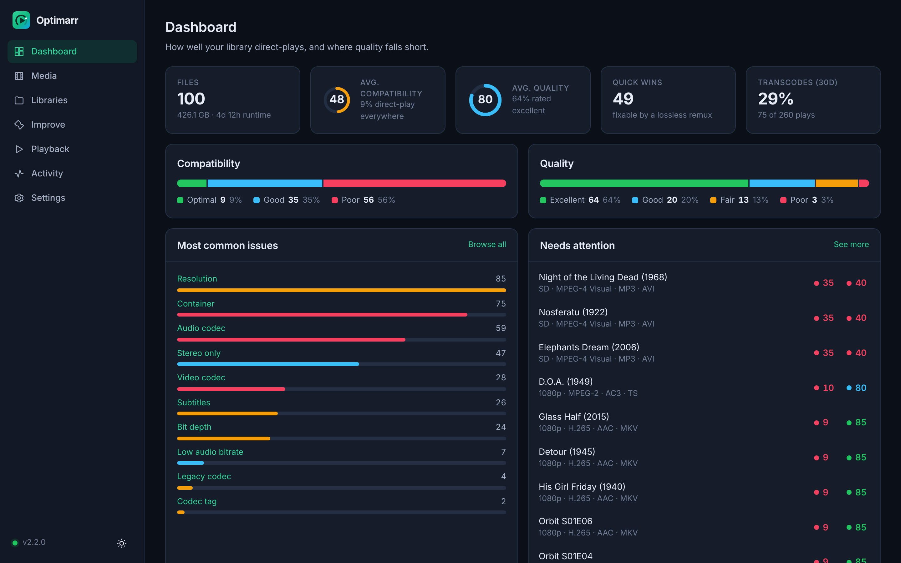
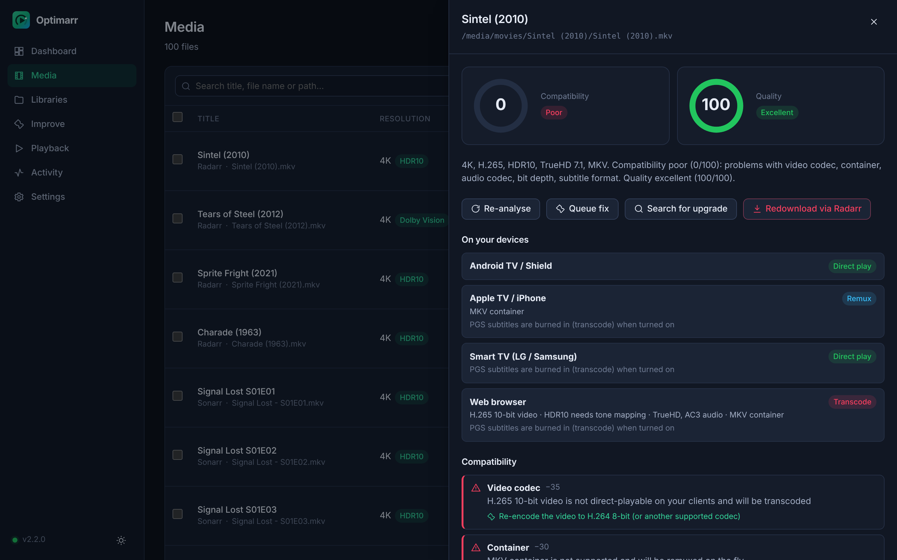
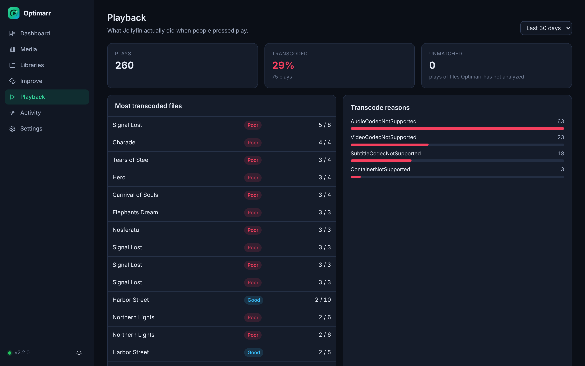
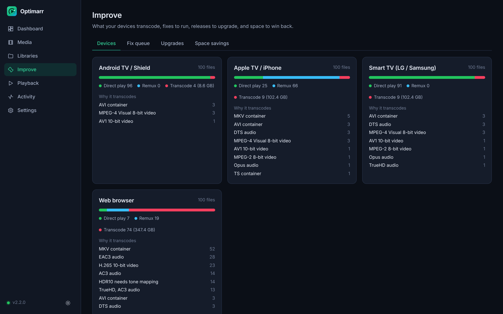
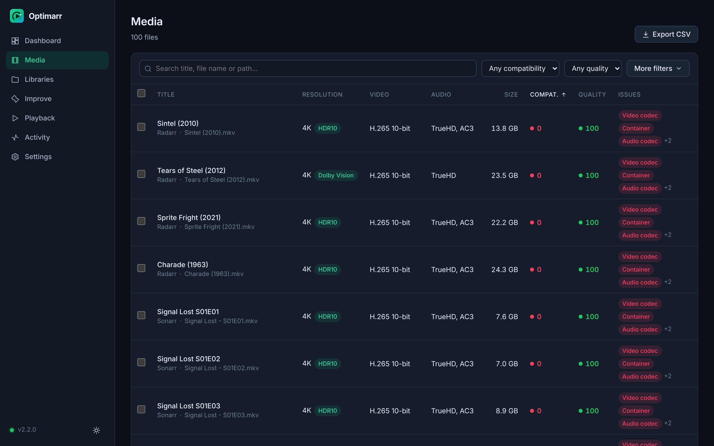
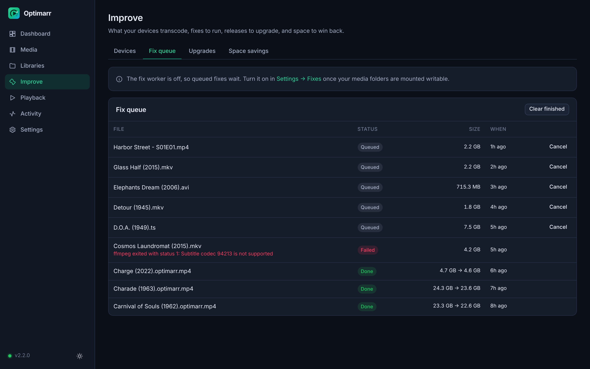
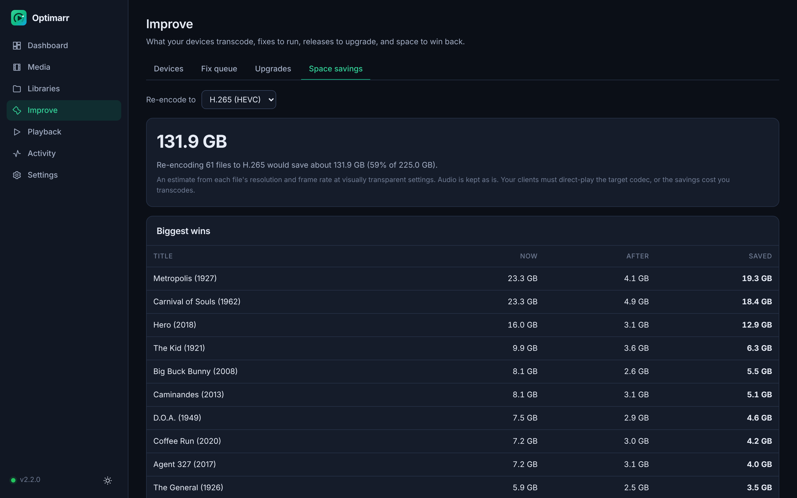

<div align="center">


# Optimarr

**Know which files will direct-play before anyone presses play.**

Optimarr scores every movie and episode in your library for compatibility and quality, shows what
Jellyfin actually transcoded, and hands you the fix.

[](https://github.com/davidsteg/optimarr/releases)
[](https://hub.docker.com/r/davidsteg/optimarr)
[](#license)

[Features](#features) · [Install](#install-with-docker) · [Screenshots](#a-closer-look) · [Agent API](docs/API.md) · [Changelog](CHANGELOG.md)

<br />

<picture>
  <source media="(prefers-color-scheme: light)" srcset="docs/screenshots/dashboard-light.png" />
  
</picture>

</div>

## Why Optimarr

A file that looks fine in Sonarr or Radarr can still force Jellyfin to transcode on half your
devices: an MKV the browser can't open, TrueHD audio the TV can't decode, PGS subtitles that get
burned in. Optimarr scans your folders, explains each problem in plain language, and tells you
whether a quick lossless remux fixes it or whether you should grab a better release.

It is a single small Rust binary with the web UI built in, a SQLite database and live progress in
the browser.

## Features

| | |
| --- | --- |
| 🎯 **Two scores per file** | Compatibility (will it direct-play?) and quality (are bitrate, codec, resolution and audio good enough?), each 0–100 with a verdict and a list of issues. |
| 🛠️ **Fixes, not just warnings** | Every issue says how to fix it, and fixable files get a ready-to-run ffmpeg command. |
| 📺 **Device profiles** | Describe your TVs, phones and browsers and see, per file and per device, whether it direct-plays, gets remuxed or gets transcoded, and why. |
| ▶️ **Real playback history** | Imports Jellyfin's playback history from [Jellystat](https://github.com/CyferShepard/Jellystat) and shows which files were transcoded, on which clients, and why. |
| 🔗 **Sonarr and Radarr** | Root folders become libraries automatically, files are linked to series and movies, and import webhooks trigger a rescan right away. |
| ⚙️ **Fix queue** | Run the suggested ffmpeg fix for one file or hundreds. The original is kept as `.orig` by default and Sonarr/Radarr are told to rescan. Off by default. |
| ⬆️ **Upgrade finder** | Ask Sonarr/Radarr to look for a better release of low-quality files without deleting them, by hand or on a schedule. |
| 💾 **Space savings** | See how much re-encoding to HEVC or AV1 would save, per file and in total. |
| 🌐 **Language checks** | Flag files missing your audio or subtitle languages, or with image-only subtitles that force a transcode. |
| 🔔 **Notifications** | Discord, ntfy or a webhook when new files arrive broken or poor, or when a fix finishes. |
| ⚡ **Fast, incremental scans** | Unchanged files are skipped, folders are watched for new files, and progress is shown live. |
| 🤖 **Agent API** | A small, stable JSON API for AI agents and scripts, see [docs/API.md](docs/API.md). |

Upgrading from Optimarr 1.x? Settings and the analysis database are imported on first start.

## A closer look

<table>
  <tr>
    <td width="50%">
      
      <p align="center"><b>Every file, explained.</b> Scores, per-device verdicts and how to fix each issue.</p>
    </td>
    <td width="50%">
      
      <p align="center"><b>What Jellyfin really did.</b> The most transcoded files and the reasons behind them.</p>
    </td>
  </tr>
  <tr>
    <td width="50%">
      
      <p align="center"><b>Per-device verdicts.</b> How much of your library each client can direct-play.</p>
    </td>
    <td width="50%">
      
      <p align="center"><b>Search and filter everything.</b> By codec, container, HDR, score or issue.</p>
    </td>
  </tr>
  <tr>
    <td width="50%">
      
      <p align="center"><b>Fix in bulk.</b> Queue lossless remuxes and track them as they run.</p>
    </td>
    <td width="50%">
      
      <p align="center"><b>Win back space.</b> Estimated savings from re-encoding to HEVC or AV1.</p>
    </td>
  </tr>
</table>

<sub>Screenshots use demo data: open movies from the Blender Studio, public domain classics and made-up series.</sub>

## Install with Docker

```yaml
services:
  optimarr:
    image: davidsteg/optimarr:latest
    container_name: optimarr
    ports:
      - "8080:8080"
    environment:
      - PUID=1000
      - PGID=1000
    volumes:
      - ./data:/app/data
      - ./logs:/app/logs
      - ./config:/app/config:ro
      - /path/to/media:/media:ro
    restart: unless-stopped
```

Then:

1. Open `http://<host>:8080`.
2. Connect Sonarr and Radarr under **Settings**; their root folders are added as libraries. Or go
   to **Libraries** and add `/media/movies`, `/media/tv` and so on by hand.
3. Optionally connect Jellystat under **Settings → Jellystat** to see what actually got transcoded.

Mount your media at the same path Sonarr, Radarr and Jellyfin use if you can. Otherwise add a path
mapping in each integration's settings.

<details>
<summary><b>Upgrading from Optimarr 1.x</b></summary>

Keep the same `data` and `config` volumes. On first start Optimarr 2 imports
`config/appsettings.json` and `data/optimarr.db` into a new `data/optimarr2.db`; the old files are
left untouched, so you can go back to 1.x. The port inside the container is still 8080.

</details>

<details>
<summary><b>Environment variables</b></summary>

| Variable | Default | Purpose |
| --- | --- | --- |
| `OPTIMARR_API_KEY` | generated | Fix the API key instead of generating one |
| `OPTIMARR_BIND` | `0.0.0.0:8080` | Listen address |
| `OPTIMARR_DATA_DIR` | `/app/data` | Database folder |
| `OPTIMARR_CONFIG_DIR` | `/app/config` | Where a 1.x `appsettings.json` is looked for |
| `OPTIMARR_LOG_DIR` | `/app/logs` | Daily log files (14 kept); empty disables |
| `OPTIMARR_LOG` | `info` | Log filter, e.g. `debug` or `info,optimarr=debug` |
| `OPTIMARR_CORS_ORIGINS` | none | Extra allowed origins, comma separated |
| `PUID` / `PGID` | `1000` | User and group the server runs as |

</details>

<details>
<summary><b>Fixing files in place</b></summary>

The fix queue writes to your media folders, so mount them without `:ro` and turn the worker on under
**Settings → Fixes & upgrades**. The image includes ffmpeg.

</details>

## Security

The API key is shown under **Settings → Security**. By default it is only required for requests
from outside your network (LAN, loopback and Tailscale addresses are trusted). If Optimarr sits
behind a reverse proxy, every request looks local, so set the mode to **Always**.

## Agent API

`/api/agent/…` gives agents a library overview, file search, a quality report per file (by id,
path or title), the most-transcoded files, per-device verdicts, space savings, upgrade candidates,
the fix queue and recent notifications, plus rescan, fix, upgrade and redownload actions. Every
report includes a plain-language summary. See [docs/API.md](docs/API.md).

## Development

You need Rust (stable), Node 22, and MediaInfo or ffprobe on the `PATH`.

```bash
cd frontend && npm ci && npm run build && cd ..
cargo run -- --data-dir ./data
```

For UI work, run the backend and `npm run dev` in `frontend/` (Vite proxies `/api` to
`http://127.0.0.1:8080`, or `OPTIMARR_URL`).

```bash
cargo test
cd frontend && npm run check
```

The backend lives in `backend/` (Axum, Tokio, sqlx/SQLite) and embeds `frontend/build` at compile
time. The UI is SvelteKit with the static adapter. The logo lives in `docs/brand/` as SVG and PNG.

### Releases

Every version is a GitHub Release with notes from [CHANGELOG.md](CHANGELOG.md) and an amd64
image on Docker Hub, `davidsteg/optimarr:<version>` and `:latest`. The same image is on GHCR as
`ghcr.io/davidsteg/optimarr`.

To cut a release: bump the version in `VERSION`, `backend/Cargo.toml` and `frontend/package.json`,
turn `## [Unreleased]` in `CHANGELOG.md` into a dated `## [x.y.z]` section and merge to master. The
release workflow tags the commit, pushes the image and publishes the release. The rules for version
numbers and release notes are in [docs/RELEASING.md](docs/RELEASING.md).

## License

MIT
